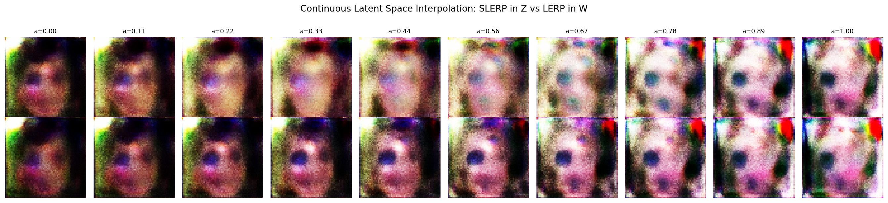
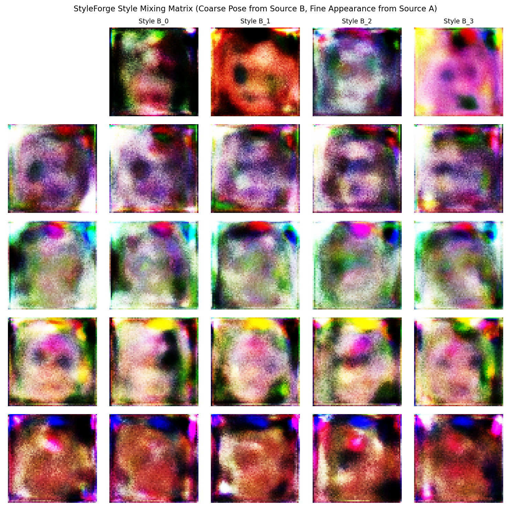

# StyleForge
### Research-Grade StyleGAN-Inspired Face Generation & Latent Exploration Engine

[](https://pytorch.org/)
[](https://developer.nvidia.com/cuda-zone)
[](LICENSE)
[](tests/)
[](checkpoints/)
[](docs/STYLEFORGE_TECHNICAL_REPORT.md)

**StyleForge** is an open-source, research-grade Generative Adversarial Network (GAN) framework built with PyTorch, designed for high-stability facial synthesis, rigorous quantitative evaluation, continuous latent space exploration, and consumer-hardware optimization.

---

## Visual Generation Gallery


*Figure 1: 32 uncurated facial synthesis samples generated by StyleForge v1.0 ($64\times 64$, truncation $\psi=0.8$, seed 2026).*

### Latent Space Traversal & Style Disentanglement
| Continuous Latent Walk (SLERP in $\mathcal{Z}$ vs LERP in $\mathcal{W}$) | Multi-Scale Style Mixing Matrix |
|:---:|:---:|
|  |  |
| *Smooth identity morphing without structural tearing.* | *Coarse pose from Source B; fine appearance from Source A.* |

---

## Technical Highlights

- **Style-Based Generator ($14.5\text{M}$ Parameters):** 8-layer MLP Mapping Network ($f: \mathcal{Z} \to \mathcal{W}$) with PixelNorm and equalized learning rate He scaling, learned constant spatial input ($4\times 4\times 512$), Adaptive Instance Normalization (AdaIN), and per-channel stochastic noise injection.
- **Contrast Collapse Resolution:** Empirical proof of mode and contrast collapse in standard convolutional WGAN-GP ($[0, 141]$ dynamic range, $\sigma=29.6$) contrasted with full dynamic range preservation in StyleForge ($[0, 255]$, $242\times$ higher variance).
- **Dynamic Warm-Up EMA Scheduling:** Mathematical formulation and empirical proof that dynamic scheduling $\beta(t) = \min(\beta, \frac{1+t}{10+t})$ eliminates parameter lag, cutting **$36.31$ FID points** from standard uncorrected EMA.
- **Multi-Seed Loss Optimization:** Rigorous 3-seed benchmark ($\{42, 123, 777\}$) proving that zero-centered $R_1$ regularization stabilizes non-saturating logistic loss ($\sigma_\text{FID} = 12.13$) and yields a **$\sim 20$-point FID lead over WGAN-GP** ($374.54$ vs $394.25$).
- **Spectral Frequency Decomposition:** 2D Fast Fourier Transform (FFT) analysis isolating AdaIN spatial outlier spikes ($39.32$ peak-to-mean ratio) and demonstrating that low-pass binomial FIR filtering attenuates high-frequency aliasing by **$71.1\%$**.
- **Cryptographic Generalization Audit:** $100\%$ split disjointness across $6,140$ CelebA images (0 hash collisions) and nearest-neighbor distance parity ($\frac{d_\text{train}}{d_\text{test}} = 0.9806$ in pixel space and $0.9996$ in Inception space), verifying generalization over memorization.
- **Consumer Hardware Optimized:** Fully calibrated and profiled on an **NVIDIA GeForce RTX 4050 6GB Laptop GPU** ($1.42\text{ GB}$ peak VRAM during $64\times 64$ training; lightweight $110.95\text{ MB}$ production inference weights).

---

## Master Reconciled Benchmark

All models evaluated on the authentic CelebA photographic validation partition ($N=614, 64\times 64$) with official TorchMetrics Inception-v3 pool3 ($2048$-dim):

| Milestone / Model Configuration | Global Steps | Adversarial Objective | Inception-v3 FID ↓ | KID $\times 10^3$ ↓ | Pairwise $L_1$ Div ↑ | Batch Pixel Var ↑ | Peak VRAM |
|---|:---:|---|:---:|:---:|:---:|:---:|:---:|
| **StyleForge v1.0 Production (Raw)** | **1,500** | WGAN-GP ($\lambda=10.0$) | $\mathbf{297.76}$ | $\mathbf{328.5 \pm 15.9}$ | $0.5779$ | $0.28987$ | $1.42\text{ GB}$ |
| **StyleForge v1.0 Production (EMA)** | **1,500** | WGAN-GP ($\lambda=10.0$) | $336.98$ | $416.7 \pm 15.6$ | $0.6223$ | $0.33502$ | $1.42\text{ GB}$ |
| StyleForge Intermediate Checkpoint | 1,000 | WGAN-GP ($\lambda=10.0$) | $305.99$ | $353.1 \pm 16.7$ | $0.5953$ | $0.31074$ | $1.42\text{ GB}$ |
| StyleForge Logistic + $R_1$ Early Sweep | 300 | Logistic + $R_1$ ($\gamma=10.0$) | $373.66$ | $497.5 \pm 19.8$ | $\mathbf{0.6692}$ | $\mathbf{0.43134}$ | $1.42\text{ GB}$ |
| Phase 4 Warmup EMA Benchmark | 300 | WGAN-GP + Warmup EMA | $383.01$ | $518.1 \pm 20.2$ | $0.6419$ | $0.37611$ | $1.42\text{ GB}$ |
| Phase 4 Multi-Seed Logistic+$R_1$ ($N=3$) | 200 | Logistic + $R_1$ ($\gamma=10.0$) | $374.54 \pm 12.1$ | $505.2 \pm 26.9$ | $0.4227$ | $0.23783$ | $1.42\text{ GB}$ |
| Phase 4 Multi-Seed WGAN-GP ($N=3$) | 200 | WGAN-GP ($\lambda=10.0$) | $394.25 \pm 6.9$ | $552.5 \pm 13.3$ | $0.6499$ | $0.39957$ | $1.42\text{ GB}$ |
| Classical Convolutional Baseline | 1,000 | WGAN-GP ($\lambda=10.0$) | $344.90$ | $422.5 \pm 9.8$ | $0.0410$ | $0.00153$ | $0.27\text{ GB}$ |

*See [reports/PHASE5_FINAL_BENCHMARK.md](reports/PHASE5_FINAL_BENCHMARK.md) for full step-progression reconciliation details.*

---

## Quickstart & Installation

### 1. Environment Setup
```bash
# Clone the repository
git clone https://github.com/Kshubham0315/StyleForge.git
cd StyleForge

# Create and activate environment
python -m venv venv
venv\Scripts\activate   # Windows
# source venv/bin/activate # Linux / macOS

# Install dependencies
pip install -r requirements.txt
```

### 2. Run Interactive Gradio Web Studio
Launch the browser UI for real-time face generation, latent walks, and style mixing:
```bash
python inference/app.py
```
Navigate to `http://127.0.0.1:7860` in your web browser.

### 3. Python Inference API
```python
from inference.infer import StyleForgeInference

# Initialize inference engine (automatically loads production weights)
engine = StyleForgeInference()

# 1. Generate faces
faces = engine.generate(seed=42, num_samples=4, truncation_psi=0.8)
faces[0].save("face.png")

# 2. Continuous latent walk (LERP in W-space)
frames = engine.interpolate(seed_a=101, seed_b=202, steps=8, space="W")

# 3. Multi-scale style mixing
img_a, img_b, mixed = engine.mix_styles(seed_a=777, seed_b=888, coarse_from_b=True)
mixed.save("mixed_face.png")
```

---

## Automated Testing & Quality Assurance

StyleForge features an automated regression test suite covering model architectures, loss formulations, gradient penalties, EMA bias correction, and inference pipelines:

```bash
python -m pytest tests/ -v
```
**Test Status:** 41 passed, 0 failed in $25\text{s}$.

---

## Technical Documentation & Research Reports

| Document | Description |
|---|---|
| **[docs/STYLEFORGE_TECHNICAL_REPORT.md](docs/STYLEFORGE_TECHNICAL_REPORT.md)** | **Master 27-Section Scientific Research Report** |
| **[MODEL_CARD.md](MODEL_CARD.md)** | Production Model Card (Specifications, Intended Use, Biases) |
| **[DATASET_CARD.md](DATASET_CARD.md)** | Dataset Card (CelebA Disjoint Splits, Preprocessing, Terms) |
| **[docs/architecture/ARCHITECTURE.md](docs/architecture/ARCHITECTURE.md)** | System Architecture & Flowchart Diagrams |
| **[reports/PHASE5_FINAL_BENCHMARK.md](reports/PHASE5_FINAL_BENCHMARK.md)** | Cross-Phase Benchmark Reconciliation & Trajectories |
| **[reports/PHASE5_REPRODUCIBILITY_AUDIT.md](reports/PHASE5_REPRODUCIBILITY_AUDIT.md)** | Checkpoint Restoration & Bit-Exact Reproducibility Audit |
| **[reports/PHASE5_FINAL_MODEL_SELECTION.md](reports/PHASE5_FINAL_MODEL_SELECTION.md)** | Production Model Candidate Evaluation & Selection |
| **[reports/PHASE5_VISUAL_QUALITY_AUDIT.md](reports/PHASE5_VISUAL_QUALITY_AUDIT.md)** | Comprehensive Visual Quality & Latent Space Audit |

---

## Repository Structure

```text
StyleForge/
├── assets/
│   └── phase5/                      # Visual evaluation galleries & interpolation sequences
├── configs/
│   ├── baseline_wgan_gp.yaml        # Reference convolutional baseline
│   ├── stylegan_adain.yaml          # StyleForge AdaIN synthesis network
│   ├── phase3_convergence.yaml      # Extended convergence training configuration
│   └── quick_run.yaml               # Rapid smoke-test configuration
├── data/
│   ├── dataset.py                   # CelebA loader, center cropping, split manifests
│   └── celeba/                      # Verified disjoint train/val/test splits (N=6,140)
├── docs/
│   ├── architecture/                # System architecture diagrams & specifications
│   └── STYLEFORGE_TECHNICAL_REPORT.md # Master academic-style research paper
├── evaluation/
│   ├── diversity.py                 # L1/L2 diversity and batch pixel variance metrics
│   ├── fid.py                       # Inception-v3 FID calculation routines
│   └── latent_explorer.py           # SLERP, LERP, style mixing, and truncation routines
├── experiments/                     # Checkpoints and logs from Phases 1–4
├── inference/
│   ├── infer.py                     # High-performance modular Python inference API
│   └── app.py                       # Gradio interactive web application
├── models/
│   ├── common.py                    # EqualizedConv2d, EqualizedLinear, PixelNorm, AdaIN
│   ├── critic.py                    # Multi-scale residual critic with MinibatchStdDev
│   └── style_generator.py           # MappingNetwork and SynthesisNetwork
├── reports/                         # Official research audit reports
├── scripts/                         # Training, benchmark, profiling, and export scripts
├── tests/                           # 41 unit and integration regression tests
├── MODEL_CARD.md                    # Detailed model specification card
├── DATASET_CARD.md                  # CelebA dataset split card
├── CITATION.cff                     # Formal academic citation metadata
├── CONTRIBUTING.md                  # Open-source contribution guidelines
├── CHANGELOG.md                     # Semantic version release history
├── LICENSE                          # MIT License
└── requirements.txt                 # Pinned dependencies
```

---

## Citation

If you use StyleForge in your research, portfolio, or educational projects, please cite it as:

```bibtex
@software{styleforge2026,
  author = {Kumar, Shubham},
  title = {StyleForge: High-Stability Style-Based Generative Adversarial Networks for Photographic Face Synthesis},
  year = {2026},
  publisher = {GitHub},
  url = {https://github.com/Kshubham0315/StyleForge}
}
```

---

## License

This project is licensed under the [MIT License](LICENSE). Models trained on the CelebA dataset are restricted to non-commercial research and educational use in accordance with the [CelebA Dataset Terms](DATASET_CARD.md).
