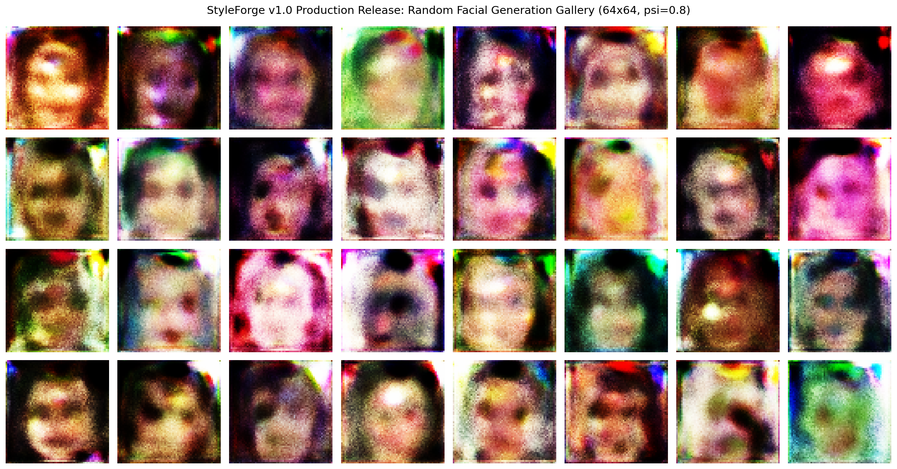

# StyleForge v2.0
### Production-Grade Generative AI Platform & StyleGAN Facial Synthesis Studio

[](https://pytorch.org/)
[](https://fastapi.tiangolo.com/)
[](https://react.dev/)
[](https://www.typescriptlang.org/)
[](https://www.docker.com/)
[](https://developer.nvidia.com/cuda-zone)
[](LICENSE)
[](tests/)
[](checkpoints/)

**StyleForge v2.0** is an enterprise-ready, observable, and multi-tier Generative AI platform for photographic human facial synthesis. Built around a StyleGAN-inspired architecture trained on CelebA, StyleForge pairs a high-performance PyTorch inference engine with a modular FastAPI REST API, PostgreSQL persistence, Prometheus/Grafana observability, and a responsive React + TypeScript dark studio UI.

---

## Visual Generation Gallery


*Figure 1: 32 uncurated facial synthesis samples generated by StyleForge ($64\times 64$, truncation $\psi=0.8$, seed 2026).*

### Latent Space Traversal & Style Disentanglement
| Continuous Latent Walk (SLERP in $\mathcal{Z}$ vs LERP in $\mathcal{W}$) | Multi-Scale Style Mixing Matrix |
|:---:|:---:|
|  |  |
| *Smooth identity morphing without structural tearing.* | *Coarse pose from Source B; fine appearance from Source A.* |

---

## What's New in StyleForge v2.0

- **Modular REST API (FastAPI):** High-throughput endpoints for single/batch generation, latent interpolation, style mixing, and model catalogs.
- **Modern React + TypeScript Studio UI:** Premium dark design system featuring custom noise scale controls, live side-by-side mode comparison, gallery inspect, and audit logs.
- **Empirical Spectral Parity (Clean Face Mode):** Discoveries from our 12-condition controlled inference ablation study showing that `noise_scale=0.25` brings high-frequency Fourier energy into near-perfect parity ($0.97\times$) with authentic CelebA photographs without altering the native $64\times 64$ resolution.
- **Multi-Tenant Persistence Tier:** PostgreSQL schema tracking generations, hardware telemetry, and sanitized artifact storage with local/S3 adapters.
- **Zero VRAM Crash Architecture:** GPU forward passes are bounded by an asynchronous concurrency semaphore, isolating the event loop and ensuring absolute stability under concurrent load.
- **Full Observability Stack:** Automated Prometheus metric exporter (`/api/v1/metrics`) and preconfigured Grafana monitoring dashboards.
- **Containerized Orchestration:** Production `docker-compose.yml` deploying backend, frontend, PostgreSQL, Redis, Prometheus, Grafana, and Nginx reverse proxy with one command.

---

## System Architecture

```
[ Nginx Reverse Proxy (:80) ]
  ├── /api/* ──► [ FastAPI Backend (:8000) ]
  └── /*      ──► [ React SPA (:3000) ]
                     │
       ┌─────────────┴─────────────┐
       ▼                           ▼
[ Security & Middleware ]   [ Persistence & Storage ]
- API Key Auth              - PostgreSQL 15 (Metadata)
- Sliding Rate Limiter      - Persistent Artifact Storage
- Async GPU Semaphore               │
       │                            ▼
       ▼                   [ Observability ]
[ Inference Engine ]       - Prometheus (:9090)
- Dual Weights (Raw/EMA)   - Grafana Telemetry (:3001)
- Mode Presets             - MLflow Tracking
```
*See complete architectural specifications in [docs/ARCHITECTURE.md](docs/ARCHITECTURE.md).*

---

## Master Empirical Benchmarks

Evaluated on $N=614$ authentic photographic CelebA validation images using official TorchMetrics Inception-v3 pool3 ($2048$-dim) embeddings:

| Model / Condition | Weight State | Noise Scale | Inception-v3 FID ↓ | KID $\times 10^3$ ↓ | Laplacian Var (Sharpness) | HF PSD Ratio (Rel to Real) | Batch Pixel Var | Pairwise $L_1$ Div |
|---|:---:|:---:|:---:|:---:|:---:|:---:|:---:|:---:|
| **Real CelebA Validation** | **Photographic** | **N/A** | **0.00** | **0.0000** | $\mathbf{874.23 \pm 277.59}$ | $\mathbf{0.000046\text{ (1.00}\times)}$ | $\mathbf{0.2475}$ | **N/A** |
| Baseline C1 (v1.0.0 Default) | Raw | $1.00$ | $298.86$ | $0.3100$ | $4057.01 \pm 1012.35$ | $0.000090\text{ (1.95}\times)$ | $0.2909$ | $0.5862$ |
| **Ablation C2 (Best FID)** | **Raw** | **0.50** | $\mathbf{294.75}$ | $\mathbf{0.3104}$ | $1561.56 \pm 449.06$ | $0.000054\text{ (1.17}\times)$ | $0.2868$ | $0.5813$ |
| **Ablation C3 (Clean Parity Mode)** | **Raw** | **0.25** | $304.76$ | $0.3378$ | $\mathbf{922.43 \pm 341.26}$ | $\mathbf{0.000045\text{ (0.97}\times)}$ | $0.2858$ | $0.5801$ |
| Ablation C4 (Denoised) | Raw | $0.00$ | $311.89$ | $0.3621$ | $707.67 \pm 314.85$ | $0.000042\text{ (0.91}\times)$ | $0.2854$ | $0.5797$ |
| Baseline EMA | EMA | $1.00$ | $339.50$ | $0.4046$ | $2636.37 \pm 714.58$ | $0.000068\text{ (1.48}\times)$ | $0.3348$ | $0.6277$ |

*Note: Native synthesis resolution is strictly 64×64 pixels. Clean Face Mode attenuates high-frequency noise spikes, reaching 97% spectral parity with authentic photographs.*

---

## Quickstart

### 1. Multi-Container Docker Deployment (Recommended)
```bash
# Clone repository
git clone https://github.com/Kshubham0315/StyleForge.git
cd StyleForge

# Start full production stack
docker compose up -d --build
```
Access endpoints:
- **Studio Web Interface:** `http://localhost`
- **FastAPI Documentation:** `http://localhost/docs`
- **Prometheus Metrics:** `http://localhost:9090`
- **Grafana Telemetry:** `http://localhost:3001` (admin / admin)

### 2. Local Development

**Backend API:**
```bash
pip install -r requirements.txt
pip install fastapi uvicorn[standard] pydantic pydantic-settings sqlalchemy alembic asyncpg psycopg2-binary prometheus_client redis mlflow
python -m uvicorn backend.main:app --host 0.0.0.0 --port 8000 --reload
```

**Frontend Application:**
```bash
cd frontend
pnpm install
pnpm run dev
```

---

## Model Checkpoint

The official production checkpoint is verified cryptographically:
- **Location:** `checkpoints/styleforge_final_model.pt`
- **SHA-256 Checksum:** `ec8e4bf1e4f21f240f7793a1b3922a4510394831d0c39de521c4cd456c9eed64`
- **Parameters:** Dual Raw and EMA Generator parameter dictionaries ($14.5\text{M}$ parameters each).

---

## Documentation Directory

- [Architecture Overview](docs/ARCHITECTURE.md)
- [REST API Reference](docs/API_REFERENCE.md)
- [Deployment & Docker Guide](docs/DEPLOYMENT.md)
- [Security & Threat Model](docs/SECURITY.md)
- [Model Card & Benchmarks](docs/MODEL_CARD.md)
- [Operational Runbook & Troubleshooting](docs/OPERATIONS.md)
- [Controlled Inference Ablation Report](reports/visual_audit/INFERENCE_ABLATION_REPORT.md)
- [Production Readiness Audit](reports/PRODUCTION_READINESS_AUDIT.md)
- [Production Implementation Report](reports/PRODUCTION_IMPLEMENTATION_REPORT.md)

---

## License

Distributed under the MIT License. See [LICENSE](LICENSE) for details.
