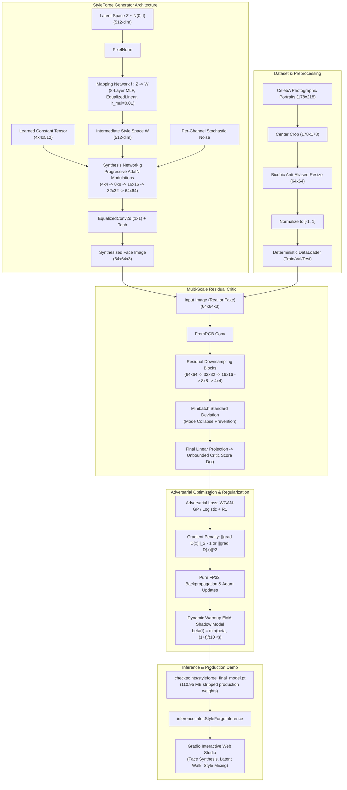
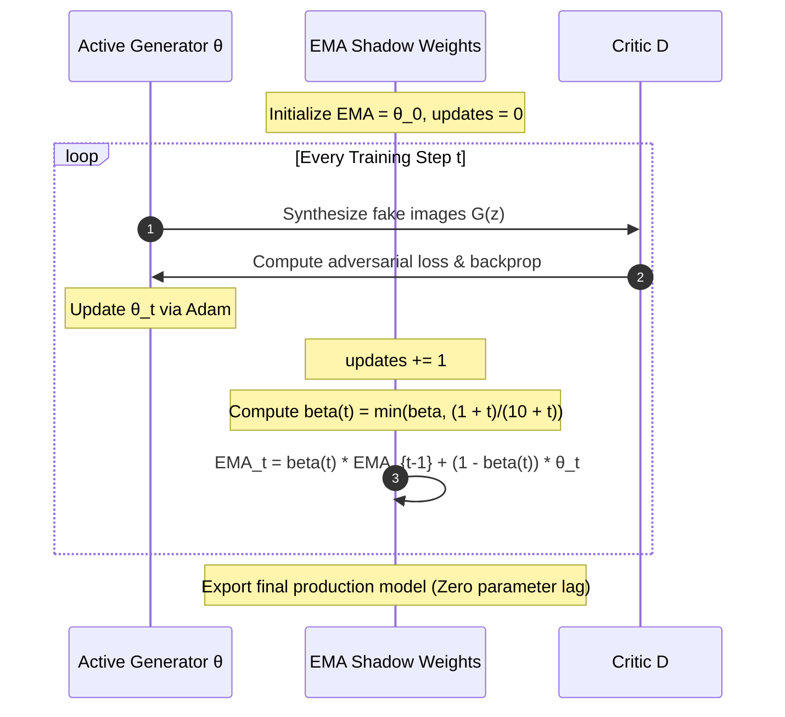

# StyleForge System Architecture

This document specifies the complete system architecture, training loops, regularization pipelines, and inference interfaces of the **StyleForge** generative engine.

---

## 1. End-to-End System Pipeline

---

## 2. Style Modulation: Adaptive Instance Normalization (AdaIN)

At each resolution layer $l$, feature maps $x \in \mathbb{R}^{B \times C \times H \times W}$ are normalized across spatial dimensions $(H, W)$ and modulated by learned affine transformations of the intermediate style vector $w \in \mathcal{W}$:

$$\mu(x_c) = \frac{1}{HW} \sum_{h=1}^H \sum_{w=1}^W x_{c, h, w}$$

$$\sigma(x_c) = \sqrt{\frac{1}{HW} \sum_{h=1}^H \sum_{w=1}^W (x_{c, h, w} - \mu(x_c))^2 + \epsilon}$$

$$\text{AdaIN}(x, w) = y_{s, c}(w) \cdot \left(\frac{x_c - \mu(x_c)}{\sigma(x_c)}\right) + y_{b, c}(w)$$

where $(y_{s, c}, y_{b, c}) = \text{EqualizedLinear}(w)$.

---

## 3. Dynamic Warm-Up EMA Pipeline

---

## 4. Component Parameter Breakdown

| Component | Layer Count | Input Dimension | Output Dimension | Trainable Parameters |
|---|:---:|:---:|:---:|---:|
| **Mapping Network ($f$)** | 8 | $512$ (Gaussian $z$) | $512$ (Disentangled $w$) | $2,098,176$ |
| **Synthesis Network ($g$)** | 10 blocks | $4\times 4\times 512$ | $64\times 64\times 3$ | $12,437,699$ |
| **Total Generator ($G$)** | — | **512** | **$64\times 64\times 3$** | **$14,535,875$** |
| **StyleCritic ($D$)** | 5 residual stages | $64\times 64\times 3$ | Scalar $1$ | **$12,174,721$** |
| **Total System** | — | — | — | **$26,710,596$** |
