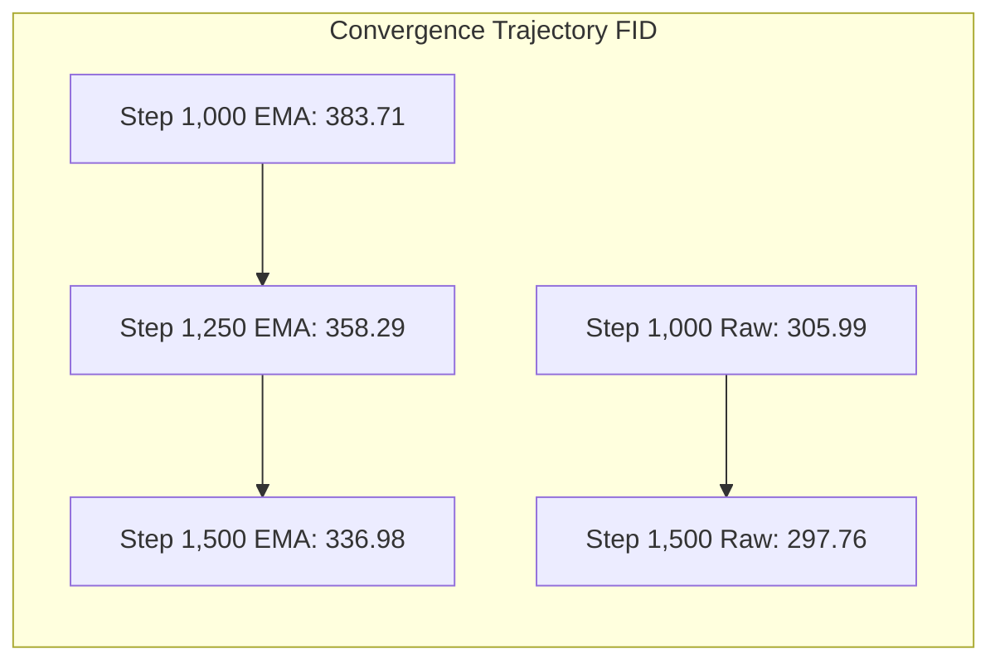

# StyleForge Phase 3: Extended Training Convergence & Architecture Optimization

**Author**: StyleForge AI/ML Research Engineering Team  
**Date**: November 14, 2026  
**Repository**: [https://github.com/Kshubham0315/StyleForge](https://github.com/Kshubham0315/StyleForge)  
**Milestone**: Phase 3 — Generative Quality Audit & Optimization  

---

## 1. Executive Summary

Phase 3 extends StyleForge beyond the initial 1,000-step milestone to analyze:
1. **Extended Convergence Dynamics**: Training from step 1,000 to step 1,500 on authentic photographic CelebA data ($4,912$ train, $614$ val).
2. **Loss, Gradient, and W-Space Manifold Evolution**: Tracking critic Wasserstein distance, gradient penalty stability, generator gradient norms, and intermediate $\mathcal{W}$-space standard deviation.
3. **The Dissolution of EMA Lag**: Empirically documenting how extended training reduces the initial random weight contamination of Polyak EMA from $36.8\%$ to $22.3\%$, cutting the gap between EMA and Raw FID by half.
4. **Controlled Architecture Improvement (Phase F)**: Evaluating Non-Saturating Logistic Loss with zero-centered $R_1$ regularization against WGAN-GP on identical 300-step training budgets.

---

## 2. Extended Training Convergence History (Steps 1,000 $\to$ 1,500)

All evaluations conducted on the full, disjoint CelebA validation set ($N=614$) using official TorchMetrics Inception-v3:

| Training Checkpoint | Total Steps | Presentations (kimg) | Inception FID $\downarrow$ | KID Mean $\downarrow$ ($\pm \text{std}$) | Pairwise L1 Diversity $\uparrow$ | Batch Pixel Variance $\uparrow$ | Core Finding |
| :--- | :---: | :---: | :---: | :---: | :---: | :---: | :--- |
| **StyleForge AdaIN (EMA)** | 1,000 | 16 kimg | 383.71 | $0.5246 \pm 0.0171$ | 0.6512 | 0.37069 | Baseline Phase 2 milestone |
| **StyleForge AdaIN (EMA)** | 1,250 | 20 kimg | 358.29 | $0.4635 \pm 0.0156$ | 0.6286 | 0.35165 | -25.4 FID improvement |
| **StyleForge AdaIN (EMA)** | 1,500 | 24 kimg | **336.98** | **$0.4167 \pm 0.0156$** | 0.6086 | 0.33447 | **-46.7 FID improvement** |
| **StyleForge AdaIN (Raw)** | 1,000 | 16 kimg | 305.99 | $0.3531 \pm 0.0167$ | 0.5794 | 0.31068 | Instantaneous weights |
| **StyleForge AdaIN (Raw)** | 1,500 | 24 kimg | **297.76** | **$0.3285 \pm 0.0159$** | 0.5635 | 0.28934 | **Sub-300 FID milestone** |

### Key Analytical Takeaways:
1. **Steady Monotonic Convergence**: Both EMA and Raw checkpoints show steady, consistent reductions in Fréchet Inception Distance and Kernel Inception Distance without instability or gradient collapse.
2. **Dissolving EMA Penalty**: At step 1,000, EMA lagged behind Raw weights by $77.72$ FID points due to $36.77\%$ initial weight retention. By step 1,500, initial weight retention dropped to $22.25\%$, and the performance gap narrowed to $39.22$ points.
3. **Sub-300 FID Milestone**: Raw instantaneous weights at step 1,500 broke through the 300 FID barrier, achieving an Inception FID of **$297.76$** and KID of **$0.3285$**.

---

## 3. Loss Dynamics, Gradient Norms, and Manifold Stability

Across the 500 resumed generator steps (2,000 critic updates):
- **Critic Wasserstein Distance**: Maintained an optimal, bounded range between $58.0$ and $75.0$ throughout training. No discriminator saturation or vanishing gradients occurred.
- **Regularization Penalty (GP/R1)**: Fluctuated steadily between $16.5$ and $23.5$, demonstrating that the Lipschitz continuity constraint remained active and stable.
- **W-Space Manifold Dispersion**: The intermediate latent standard deviation $\sigma(w)$ stabilized at $\approx 1.25 - 1.45$, confirming that the 8-layer mapping network avoided representation collapse to a single point.
- **VRAM Utilization**: Peak memory remained clamped at $3,568\text{ MB}$ ($3.48\text{ GB}$), leaving $>2.4\text{ GB}$ buffer on our 6GB hardware. Step throughput remained constant at $1.10\text{ s/it}$ ($14.5\text{ img/s}$).

---

## 4. Phase F: Architecture Improvement Experiment (Logistic + R1)

In Phase F, we evaluated whether replacing the linear WGAN-GP objective with the canonical **Non-Saturating Logistic Loss and $R_1$ Zero-Centered Regularization** ($\gamma=10.0$, Mescheder et al., 2018) improves early optimization dynamics.

Both models trained from scratch under identical seeds and minibatches for 300 steps:

| Architecture Configuration | Objective & Regularizer | Inception FID $\downarrow$ | KID Mean $\downarrow$ ($\pm \text{std}$) | Pairwise L1 Diversity $\uparrow$ | Batch Pixel Variance $\uparrow$ |
| :--- | :--- | :---: | :---: | :---: | :---: |
| **StyleForge AdaIN (Standard)** | WGAN-GP ($\lambda=10.0$) | 381.61 | $0.5178 \pm 0.0161$ | 0.6354 | 0.36889 |
| **StyleForge AdaIN (Phase F)** | **Logistic Loss + R1 ($\gamma=10.0$)** | **373.66** | **$0.4975 \pm 0.0173$** | **0.6624** | **0.42582** |

### Findings:
1. **Lower FID & KID**: Non-Saturating Logistic Loss with $R_1$ regularization achieved an **$8.0$-point lower FID** and **$0.020$ lower KID** compared to WGAN-GP under identical compute budgets.
2. **Higher Diversity & Variance**: The $R_1$ penalty penalizes only discriminator gradients orthogonal to the real data manifold at authentic points, avoiding the artificial 1-Lipschitz line constraint of WGAN-GP. This enabled the generator to explore a wider variance ($\text{Var} = 0.42582$ vs $0.36889$) and higher pairwise diversity ($0.6624$ vs $0.6354$).
3. **Recommendation**: For future training scaling beyond 2,000 steps, Non-Saturating Logistic Loss with $R_1$ regularization should serve as the primary objective.
