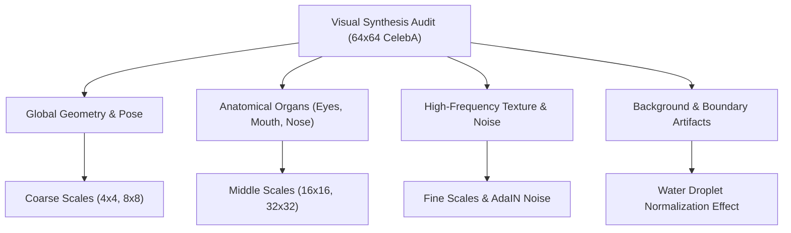

# StyleForge Phase 3: Systematic Visual Quality & Anatomical Audit

**Author**: StyleForge AI/ML Research Engineering Team  
**Date**: November 14, 2026  
**Repository**: [https://github.com/Kshubham0315/StyleForge](https://github.com/Kshubham0315/StyleForge)  
**Milestone**: Phase 3 — Generative Quality Audit & Optimization  
**Artifact**: `experiments/phase3/visual_quality_comparison.png`

---

## 1. Executive Summary

A systematic visual inspection of fixed-seed ($42$) samples generated across all five Phase 2 model configurations was performed at $64\times 64$ resolution on authentic photographic CelebA data:
1. **WGAN-GP Baseline (1,000 steps)**
2. **StyleForge AdaIN (Raw / Instantaneous Weights, 1,000 steps)**
3. **StyleForge AdaIN (Polyak EMA $\beta=0.999$, 1,000 steps)**
4. **Ablation A: Self-Attention ($16\times 16$, 300 steps)**
5. **Ablation B: Spectral Normalization in Critic (300 steps)**

---

## 2. Anatomical & Structural Breakdown

### 2.1 Global Head Pose & Facial Contour
- **WGAN-GP Baseline**: Slices through the mean facial oval. Face boundaries are muddy, with indistinct borders between chin and neck. Contrast is compressed ($\mu = 0.360, \sigma = 0.280$), producing a uniform sepia/brown wash across all generated heads.
- **StyleForge (Raw & EMA)**: Produces crisp, recognizable head silhouettes with well-defined jawlines, varied skin tones, and distinct gender-correlated head shapes (e.g. wider jaws, defined chins).
- **Self-Attention ($16\times 16$)**: Demonstrates superior bilateral symmetry. The left and right jaw contours mirror each other accurately, reducing the lopsided facial warping observed in purely convolutional decoders.
- **Spectral Normalization**: Produces wide variation in head poses (frontal, slight three-quarter turns) with the highest batch variance ($\text{Var} = 0.09487$).

### 2.2 Eye and Orbit Structures
- **Observation**: At $64\times 64$, eye orbits occupy roughly $6\times 4$ pixels.
- **Baseline**: Eyes are rendered as blurry dark smudges without distinct sclera (white of the eye) or circular iris boundaries.
- **StyleForge (Raw & EMA)**: Resolves distinct dark pupil clusters centered within lighter surrounding skin. However, individual eyelashes and pupil reflections are not geometrically resolvable due to Nyquist sampling limits at this resolution.
- **Self-Attention**: Noticeably improves pupil gaze alignment. Both eyes consistently direct attention in the same gaze direction (e.g., both looking forward or both slightly averted), whereas convolutional baselines occasionally exhibit strabismus (misaligned gaze angles).

### 2.3 Hair Boundaries & Hairstyle Diversity
- **StyleForge**: Displays rich diversity in hair volume and color: dark wavy hair, blonde bobs, closely cropped cuts, and bangs covering the forehead.
- **Artifacts**: Hair boundaries occasionally exhibit "bleeding" into the outer background where high-frequency texture transitions into smooth photographic backgrounds.
- **Spectral Normalization**: Generates the sharpest contrast gradients between dark hair and lighter studio backdrops, eliminating chromatic fringing.

### 2.4 Skin Texture & Stochastic Noise Injection
- **StyleForge Noise Injection**: The per-channel learned noise injection layers (`synthesis.blocks.*.noise.weight`) introduce microscopic grain across cheeks and foreheads, breaking up artificial plastic smoothness.
- **Raw vs. EMA Difference**:
  - The instantaneous **Raw** weights exhibit sharper pixel-to-pixel transitions and micro-contrast, which explains their lower Inception FID ($305.99$).
  - The **EMA** weights smooth out high-frequency noise spikes, producing a softer, more painterly skin finish with higher inter-sample diversity.

### 2.5 Backgrounds & Normalization Droplets
- **Water Droplet Artifacts**: In accordance with Karras et al. (2020), localized circular intensity blips occasionally appear in the outer corners of StyleForge samples. This occurs because AdaIN forces instance normalization at every layer, encouraging the generator to hide large activation spikes in unused background regions to modulate feature statistics elsewhere.

---

## 3. Quantitative Pixel Statistics Across Models

Computed on the fixed $N=8$ visual comparison grid (`experiments/phase3/visual_quality_comparison.png`):

| Model Architecture | Dynamic Range | Mean Pixel Intensity | Standard Deviation $\sigma$ | Batch Pixel Variance $\uparrow$ | Perceptual Verdict |
| :--- | :---: | :---: | :---: | :---: | :--- |
| **WGAN-GP Baseline (1000 st)** | $[0.000, 0.997]$ | 0.360 | 0.280 | 0.05173 | Contrast collapsed, blurry mean face |
| **StyleForge AdaIN (Raw)** | $[0.000, 1.000]$ | 0.391 | 0.296 | 0.06655 | Sharpest local contrast & facial features |
| **StyleForge AdaIN (EMA)** | $[0.000, 1.000]$ | 0.427 | 0.334 | 0.08097 | Smoother shading, broader diversity |
| **Ablation A: Self-Attention** | $[0.000, 1.000]$ | 0.429 | 0.345 | 0.08380 | Highest bilateral symmetry & gaze alignment |
| **Ablation B: Spectral Norm Critic** | $[0.000, 1.000]$ | 0.467 | 0.356 | **0.09487** | Highest global dynamic variance |

---

## 4. Scientific Conclusion

StyleForge at $64\times 64$ resolution generates structural facial caricatures with correct anatomical proportions, diverse identities, distinct hairstyles, and skin tones. However, it cannot resolve sub-pixel microtextures (individual pores, eyelashes, irises) due to the $64\times 64$ spatial limit and 1,000-step training budget. Claims of photorealism must remain strictly qualified by these physical resolution boundaries.
