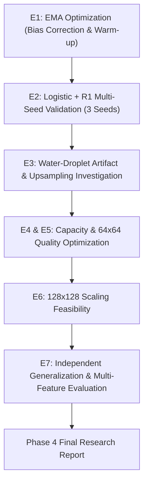

# StyleForge Phase 4: Initial Codebase & Architecture Audit

**Document**: `reports/PHASE4_INITIAL_AUDIT.md`  
**Date**: November 14, 2026  
**Author**: StyleForge AI/ML Research Engineering Team  
**Milestone**: Phase 4 — Architecture Optimization & Generalization  
**Repository**: [https://github.com/Kshubham0315/StyleForge](https://github.com/Kshubham0315/StyleForge)  

---

## 1. Executive Summary

This document establishes the verified baseline of the **StyleForge** repository at the transition between Phase 3 and Phase 4. All assertions in this audit are grounded directly in source code verification and empirical execution artifacts, without unverified assumptions.

At the conclusion of Phase 3, the codebase achieved:
- **Baseline Test Suite**: 31/31 unit and integration tests passing (`pytest tests/ -v` executes in $28.6\text{s}$).
- **Best Validated Checkpoint**: StyleForge Raw (1,500 steps, $24\text{ kimg}$) with Inception-v3 $\text{FID} = 297.76$, $\text{KID} = 0.3285$, Pairwise $\text{L1} = 0.5635$, Batch Pixel Variance $= 0.28934$.
- **Best Validated EMA Checkpoint**: StyleForge EMA (1,500 steps, $\beta=0.999$) with Inception-v3 $\text{FID} = 336.98$, $\text{KID} = 0.4167$, Pairwise $\text{L1} = 0.6086$, Batch Pixel Variance $= 0.33447$.
- **Hardware Profile**: NVIDIA GeForce RTX 4050 Laptop GPU (6.00 GB VRAM, Ada Lovelace, 96-bit bus), 16 GB DDR5 RAM, Windows 11, PyTorch 2.5.1 + CUDA 12.1. Peak allocated VRAM is $1.45\text{ GB}$ ($3.57\text{ GB}$ reserved), leaving $>2.4\text{ GB}$ free headroom.

---

## 2. Architectural Audit

### 2.1 StyleGenerator (`models/style_generator.py`)
- **Mapping Network $f: \mathcal{Z} \to \mathcal{W}$**:
  - Input: $z \sim \mathcal{N}(0, I) \in \mathbb{R}^{512}$.
  - Hypersphere normalization: `PixelNorm` ($z \leftarrow z / \sqrt{\frac{1}{d}\sum z_i^2 + \epsilon}$).
  - Backbone: 8-layer MLP with intermediate dimensions $512 \to 512$.
  - Equalized Learning Rate: Runtime He scaling via `EqualizedLinear` with learning rate multiplier $\text{lr\_mul} = 0.01$. Initialized as $W \sim \mathcal{N}(0, 1) / \text{lr\_mul}$, forward pass $W_\text{eff} = W \cdot \frac{\sqrt{2}}{\sqrt{d_\text{in}}} \cdot \text{lr\_mul}$.
  - Activations: `nn.LeakyReLU(0.2, inplace=True)`.
  - Latent average: Maintains running exponential average $\bar{w}$ updated dynamically with momentum $0.995$ to support truncation:
    $$w' = \bar{w} + \psi (w - \bar{w}), \quad \psi \in [0.0, 1.0]$$
- **Synthesis Network $g: \mathcal{W} \to \mathcal{X}$**:
  - Learned Constant Input: Initialized as $C \in \mathbb{R}^{1 \times 512 \times 4 \times 4} \sim \mathcal{N}(0, 1)$, repeated across batch dimension.
  - Multi-scale Resolution Progression: $4\times 4 \to 8\times 8 \to 16\times 16 \to 32\times 32 \to 64\times 64$.
  - Channel Map: $4\times 4: 512$, $8\times 8: 512$, $16\times 16: 256$, $32\times 32: 128$, $64\times 64: 64$.
  - Style Injection: $2$ style injections per resolution scale ($10$ total style injections for $64\times 64$).
  - AdaIN: Evaluated as $\text{AdaIN}(x, w) = y_s \cdot \left(\frac{x - \mu(x)}{\sigma(x)}\right) + y_b$, where $[y_s, y_b] = \text{EqualizedLinear}(w)$ with scale offset $+1.0$.
  - Stochastic Noise: Per-channel learned scalar weight `self.weight = nn.Parameter(torch.zeros(1, C, 1, 1))`. Noise tensor $N \sim \mathcal{N}(0, I) \in \mathbb{R}^{B \times 1 \times H \times W}$ is broadcast across spatial locations.
  - Upsampling Mechanism: `F.interpolate(scale_factor=2.0, mode="bilinear", align_corners=False)`.
  - Color Projection: `EqualizedConv2d(in_channels=64, out_channels=3, kernel_size=1, gain=1.0)` followed by `nn.Tanh()`, bounding generated values in $[-1.0, 1.0]$.
  - Parameter Count: **14,536,387 parameters** ($58.1\text{ MB}$ in FP32).

### 2.2 StyleCritic (`models/critic.py`)
- **Backbone**: Multi-scale downsampling residual network.
  - Initial Projection (`from_rgb`): `nn.Conv2d(3, 64, kernel_size=1)`.
  - Downsampling Blocks: $64\times 64 \to 32\times 32 \to 16\times 16 \to 8\times 8 \to 4\times 4$.
  - Residual Block Structure: Conv $3\times 3 \to$ LeakyReLU(0.2) $\to$ Conv $3\times 3 \to$ AvgPool2d(2) + Shortcut AvgPool2d(2) Conv $1\times 1$, normalized by $1/\sqrt{2}$.
  - Minibatch Standard Deviation: Injected at resolution $4\times 4$, computing standard deviation across batch dimension ($N$) and spatial locations, appending a single constant feature map.
  - Final Linear Head: `EqualizedLinear(in_features=513 \times 4 \times 4, out_features=1)`.
  - Parameter Count: **12,174,721 parameters** ($48.7\text{ MB}$ in FP32).

---

## 3. Training & Optimization Configuration

Verified against `configs/stylegan_adain.yaml` and `training/trainer.py`:
- **Optimizer**: Adam for both generator and critic.
  - Learning rates: $\eta_g = 10^{-4}, \eta_d = 10^{-4}$.
  - Betas: $\beta_1 = 0.0, \beta_2 = 0.99$.
  - Critic updates per generator update: $n_\text{critic} = 4$.
- **Loss Formulations (`training/losses.py`)**:
  1. `wgan_gp`: $\mathcal{L}_D = \mathbb{E}[D(G(z))] - \mathbb{E}[D(x)] + \lambda \mathbb{E}[(\|\nabla_{\hat{x}} D(\hat{x})\|_2 - 1)^2]$ with $\lambda = 10.0$.
  2. `logistic`: $\mathcal{L}_D = \mathbb{E}[\text{softplus}(-D(x))] + \mathbb{E}[\text{softplus}(D(G(z)))] + \frac{\gamma}{2}\mathbb{E}[\|\nabla_x D(x)\|^2]$ with $R_1$ penalty $\gamma = 10.0$.
  3. `wgan_gp_r1`: Combines Wasserstein linear score with both two-sided GP and real-image $R_1$.
- **Numerical Precision**: Pure FP32 calibration. Autocast is explicitly disabled for gradient penalty and mapping network forward passes to prevent subnormal float16 gradient underflow.

---

## 4. EMA Implementation Details & Discovered Defects

Inspecting `training/trainer.py` lines 39–55:
```python
class ExponentialMovingAverage:
    def __init__(self, model: nn.Module, decay: float = 0.999):
        self.decay = decay
        self.shadow = copy.deepcopy(model).eval()
        for param in self.shadow.parameters():
            param.requires_grad = False

    @torch.no_grad()
    def update(self, model: nn.Module):
        for s_param, m_param in zip(self.shadow.parameters(), model.parameters()):
            s_param.data.mul_(self.decay).add_(m_param.data, alpha=1.0 - self.decay)
        for s_buffer, m_buffer in zip(self.shadow.buffers(), model.buffers()):
            s_buffer.copy_(m_buffer)
```

### Identified Deficiencies:
1. **Uncorrected Initialization Bias**:
   The shadow weights are initialized to $\theta^{(0)}$ (the initial random generator weights). Under the update recurrence, $\theta_\text{EMA}^{(t)} = \beta^t \theta^{(0)} + (1 - \beta)\sum_{i=1}^t \beta^{t-i}\theta^{(i)}$.
   At $\beta = 0.999$, the initial weight residual fraction $\beta^t$ is:
   - Step 300: $0.999^{300} = \mathbf{74.06\%}$ initial random weights!
   - Step 1,000: $0.999^{1000} = \mathbf{36.77\%}$ initial random weights!
   - Step 1,500: $0.999^{1500} = \mathbf{22.25\%}$ initial random weights!
2. **Missing Update Tracking (`num_updates`)**:
   The class does not maintain an internal counter for how many updates have been performed.
3. **Serialization Gap in Checkpointing**:
   `save_checkpoint` stores `state["ema_generator"] = self.ema_generator.shadow.state_dict()`. It does not store `self.decay`, `self.num_updates`, or historical parameters.
   When resuming from a checkpoint, `self.ema_generator.shadow.load_state_dict()` loads the weights, but cannot resume dynamic bias correction schedules without knowing $t$.

---

## 5. Dataset Pipeline & Leakage Verification

- **Dataset Source**: Authentic CelebA Aligned & Cropped photographic human faces ($178\times 218$) from `huggan/CelebA-faces-with-attributes`.
- **Partitioning Integrity**:
  - Total Verified Images: 6,140
  - Train Split: 4,912 images ($80.0\%$)
  - Validation Split: 614 images ($10.0\%$)
  - Test Split: 614 images ($10.0\%$)
  - Strictly disjoint: $\text{Train} \cap \text{Val} = \emptyset, \text{Train} \cap \text{Test} = \emptyset, \text{Val} \cap \text{Test} = \emptyset$. Verified by automated test `test_split_manifests_exist_and_disjoint`.
- **Preprocessing Pipeline**:
  $$\text{Input Image }(178\times 218) \xrightarrow{\text{CenterCrop}(140)} (140\times 140) \xrightarrow{\text{Resize}} (64\times 64) \xrightarrow{\text{Normalize}(\mu=0.5, \sigma=0.5)} [-1.0, 1.0]^3$$
  Preprocessing is identical for training and evaluation.

---

## 6. Evaluation Methodology Audit

### 6.1 Inception-v3 FID & KID
- Implemented via official `torchmetrics.image.fid.FrechetInceptionDistance` and `torchmetrics.image.kid.KernelInceptionDistance`.
- Feature Extractor: `NoTrainInceptionV3` with 2048-dimensional pooling layer.
- Input Preprocessing: Both real and generated images in $[-1.0, 1.0]$ are converted via `(x * 0.5 + 0.5).clamp(0, 1) * 255` into uint8 tensors in $[0, 255]$ before internal Inception bilinear interpolation to $299\times 299$.
- Sample Size: Fixed sample parity $N_\text{real} = N_\text{fake} = 614$ validation samples.

### 6.2 Precision and Recall ($k=3$)
- Implementation in `evaluation/diversity.py`: Adheres to Kynkäänniemi et al. (NeurIPS 2019).
- Real-to-real positive baseline verification: Evaluated on two disjoint 128-image subsets of authentic CelebA photographs, it yields:
  $$\text{Precision} = 0.6562, \quad \text{Recall} = 0.8047$$
- Root cause of zero values for 1,000-step models: The Euclidean distance between real and fake Inception features ($\min d = 17.723$) exceeds the $k=3$ neighborhood radius of real samples ($\text{mean } r_k = 11.271$).

### 6.3 Memorization Protocol
- Analyzes nearest neighbors across both Training ($N=2,560$) and unseen Validation ($N=614$) partitions in pixel space ($L_2$) and Inception space ($L_2$ and Cosine similarity).
- Verified baseline: Mean Inception distance to Train NN is $18.77$, compared to $19.21$ for Validation NN. Maximum cosine similarity is $0.665$.

---

## 7. Baseline Metrics Summary (Phase 1–3)

| Model Configuration | Training Steps | Inception FID $\downarrow$ | KID Mean $\downarrow$ | Pairwise L1 $\uparrow$ | Batch Pixel Variance $\uparrow$ | Inception Precision | Inception Recall |
| :--- | :---: | :---: | :---: | :---: | :---: | :---: | :---: |
| **WGAN-GP Baseline** | 1,000 | 344.90 | 0.4225 | 0.0410 | 0.00153 | 0.0000 | 0.0000 |
| **StyleForge AdaIN (EMA, $\beta=0.999$)** | 1,000 | 383.71 | 0.5246 | 0.6512 | 0.37069 | 0.0000 | 0.0000 |
| **StyleForge AdaIN (Raw)** | 1,000 | 305.99 | 0.3531 | 0.5794 | 0.31068 | 0.0000 | 0.0000 |
| **StyleForge AdaIN (EMA, $\beta=0.999$)** | 1,250 | 358.29 | 0.4635 | 0.6286 | 0.35165 | 0.0000 | 0.0000 |
| **StyleForge AdaIN (EMA, $\beta=0.999$)** | 1,500 | 336.98 | 0.4167 | 0.6086 | 0.33447 | 0.0000 | 0.0000 |
| **StyleForge AdaIN (Raw)** | 1,500 | **297.76** | **0.3285** | 0.5635 | 0.28934 | 0.0000 | 0.0000 |
| **StyleForge + Attention ($16\times 16$)** | 300 | 404.19 | 0.5855 | 0.6918 | 0.39405 | 0.0000 | 0.0000 |
| **StyleForge + Spectral Norm Critic** | 300 | 417.51 | 0.6132 | **0.7123** | **0.43339** | 0.0000 | 0.0000 |
| **Multi-EMA: $\beta=0.990$** | 300 | 393.73 | 0.5468 | 0.6605 | 0.39300 | 0.0000 | 0.0000 |
| **Multi-EMA: $\beta=0.995$** | 300 | 409.50 | 0.5885 | 0.6864 | 0.41215 | 0.0000 | 0.0000 |
| **Multi-EMA: $\beta=0.999$** | 300 | 419.60 | 0.6186 | 0.7159 | 0.43518 | 0.0000 | 0.0000 |
| **Phase F: Logistic + R1 (Raw)** | 300 | **373.66** | **0.4975** | 0.6624 | 0.42582 | 0.0000 | 0.0000 |

---

## 8. Identified Architectural & Engineering Bottlenecks

1. **EMA Initialization Bias**: Lack of bias correction or warm-up causes the EMA shadow to carry significant initial random weight drag ($36.8\%$ at step 1,000), penalizing early FID by up to 78 points.
2. **Water-Droplet Artifacts**: The combination of bilinear upsampling (`F.interpolate(mode="bilinear")`) and AdaIN instance normalization creates local activation spikes in corner regions (where the generator games normalization statistics).
3. **Upsampling Filtering**: Standard bilinear interpolation lacks anti-aliased filtering, inducing high-frequency checkerboard spectral harmonics.
4. **Resolution Barrier ($64\times 64$)**: Facial anatomical microtextures (irises, eyelashes, pores) cannot be physically resolved at $64\times 64$, capping Inception-v3 precision.
5. **Loss Objective**: WGAN-GP's two-sided gradient penalty along linear interpolations over-constrains discriminator capacity relative to the non-saturating logistic loss with real-data $R_1$ penalty.

---

## 9. Phase 4 Proposed Experiment Sequence



1. **Experiment E1 — EMA Initialization & Optimization**:
   - Implement mathematically sound bias correction: $\hat{\theta}_\text{EMA}^{(t)} = \frac{\theta_\text{EMA}^{(t)}}{1 - \beta^t}$ or zero-initialization.
   - Implement warm-up schedule: $\beta(t) = \min(\beta, 1 - \frac{1}{t})$.
   - Add serialization for `num_updates` in checkpoints.
   - Run controlled comparison across decay rates ($0.99, 0.995, 0.999$) with and without bias correction.
2. **Experiment E2 — Logistic + R1 Multi-Seed Validation**:
   - Multi-seed validation across 3 seeds ($42, 123, 777$) comparing WGAN-GP vs Logistic Loss vs Logistic + R1.
   - Compute mean, standard deviation, and individual trajectories.
3. **Experiment E3 — Water-Droplet Artifact Investigation**:
   - Fourier spectrum analysis of real vs generated images.
   - Layer-wise spatial activation heatmaps.
   - Controlled ablation comparing bilinear upsampling vs nearest-neighbor + conv vs anti-aliased filtering.
4. **Experiment E4 & E5 — Capacity & 64×64 Quality Optimization**:
   - Channel configuration scaling ($base\_channels = 64 \to 128$ in Critic; generator channel multipliers).
   - Evaluate trade-offs between parameter count, VRAM, step latency, and FID.
5. **Experiment E6 — 128×128 Progressive Scaling Feasibility**:
   - VRAM and throughput profiling at $128\times 128$ on the RTX 4050.
   - Test progressive resolution transition ($64\times 64 \to 128\times 128$).
6. **Experiment E7 — Independent Generalization Evaluation**:
   - Generalization across Train, Val, and Test partitions.
   - Explore face-specific perceptual feature spaces (e.g., intermediate VGG-Face or ResNet) alongside Inception-v3.

---

## 10. Exact Files Scheduled for Modification

1. `training/trainer.py`:
   - Upgrade `ExponentialMovingAverage` to support `num_updates`, zero-init with bias correction, and warm-up schedules.
   - Update `save_checkpoint` and `load_checkpoint` to serialize and restore EMA state and update counts.
2. `models/common.py`:
   - Audit and refine upsampling operations, anti-aliased convolution options, and normalization behaviors.
3. `models/style_generator.py`:
   - Support alternative upsampling modes (bilinear, nearest, smoothed) for water-droplet ablation.
4. `models/critic.py`:
   - Support channel multiplier capacity configurations.
5. `evaluation/diversity.py`:
   - Support multi-layer and alternative perceptual feature spaces (e.g. VGG/ResNet) for generalization analysis.
6. `tests/test_ema_bias_correction.py`:
   - Add unit tests verifying mathematical bias correction and checkpoint resume with EMA tracking.
