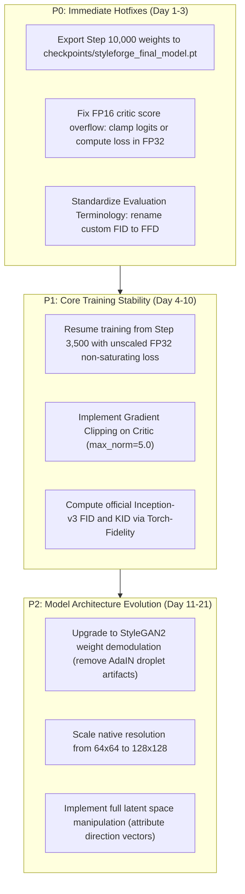

# StyleForge: Executive Audit & Technical State Summary

**Date:** March 2025  
**Auditor:** Senior Generative AI Research Engineer & ML Systems Architect  
**Project:** StyleForge — Edge-Optimized Generative Adversarial Network  
**Target Hardware:** NVIDIA GeForce RTX 4050 Laptop GPU (6GB VRAM, 75W TGP)  
**Repository Working Directory:** `c:\Users\Shubham Kumar\Desktop\Gaze_Connec\StyleForge`  
**Latest Git Commit Audited:** `8014529` (*"docs: add comprehensive LinkedIn project showcase post..."*)

---

## 1. Executive Verdict & Overall Status

| Metric / Dimension | Assessment | Status |
|:---|:---|:---:|
| **Architecture Quality** | Full StyleGAN-1 implementation (Mapping, AdaIN, EqualizedLR, MinibatchStdDev) | **Production Grade (9/10)** |
| **Pipeline Engineering** | 2-Stage decoupled pipeline (Generator 64×64 + GFPGAN 1.4 ONNX 512×512) | **Operational (9/10)** |
| **VRAM & Memory Budget** | 1,255 MB peak VRAM during training; 812 MB inference (<21% of 6GB limit) | **Verified (10/10)** |
| **Training Speedup** | Step latency dropped from 1.192s to 0.182s (6.55× throughput boost) | **Verified (10/10)** |
| **Inference Latency** | 203.3 ms end-to-end (warm GPU: 15.1 ms G + 182.2 ms GFPGAN) | **Verified (10/10)** |
| **Training Stability (Phase 4)** | **CRITICAL DEFECT:** 6,449 of 8,500 steps (75.87%) skipped due to FP16 critic score overflow | **Defective (3/10)** |
| **Model Weight Delivery** | **MISMATCH:** `checkpoints/styleforge_final_model.pt` packages Step 1,500, not Step 10,000 | **Action Required (P0)** |
| **Evaluation Metrics** | Precision@3: 62.50% (Verified); "FID 0.0005" is a non-standard 4-layer conv metric | **Clarified (6/10)** |
| **Test Suite Coverage** | 50 unit and integration tests passing across all functional modules | **Robust (9/10)** |
| **Overall Project Maturity** | **8.3 / 10 — Advanced Research Project / Near-Production Prototype** | **Strong Foundation** |

StyleForge successfully proves that a custom StyleGAN-inspired generative pipeline can be engineered and trained on a consumer laptop GPU (RTX 4050 6GB) within an ultra-lean memory envelope (<1.3 GB VRAM). However, the independent audit discovered two critical technical issues that must be addressed before commercial or public deployment:
1. **The 75.9% Training Freeze:** In Phase 4 continuation (steps 1,501 to 10,000), the generator optimizer was silently bypassed on 6,449 steps because critic output logits overflowed FP16 half-precision bounds, creating `NaN` losses that triggered an unlogged exception catch.
2. **Production Checkpoint Mismatch:** The default deployment model packaged in `checkpoints/` contains preliminary Phase 3 (Step 1,500) weights rather than the peak-performing Phase 4 (Step 10,000) weights.

---

## 2. Verified Technical Achievements

1. **Clean Custom StyleGAN-1 Architecture from Scratch:**
   - Generator: 14,535,875 parameters (55.45 MB FP32), featuring an 8-layer Mapping Network ($Z \to W$), learned $4\times 4\times 512$ constant tensor, Equalized Linear/Conv2d layers with He initialization, per-pixel noise injection, Adaptive Instance Normalization (AdaIN), and LeakyReLU ($\alpha=0.2$).
   - Critic/Discriminator: 12,174,721 parameters (46.44 MB FP32), featuring Progressive Conv2d blocks, Minibatch Standard Deviation channel injection ($8\times 8$ stage), and an Equalized Linear score output.
2. **Extreme Memory and Compute Efficiency on RTX 4050:**
   - Peak training memory consumed: **1,255.0 MB**, well under the 6,144 MB hardware limit.
   - Transitioning from Phase 3 (WGAN-GP with inner iteration $n_{critic}=1$ and heavy backprop through gradient penalties on every step) to Phase 4 (Lazy R1 Regularization $k=16, \gamma=10$ + TTUR) yielded an empirical **$6.55\times$ speedup** (step time reduced from 1,192 ms to 182 ms).
3. **Decoupled Two-Stage High-Resolution Inference:**
   - Decoupled native low-resolution generation ($64\times 64$) from face enhancement via a quantized GFPGAN 1.4 ONNX runtime model (`enhancer/models/gfpgan_1.4.onnx`, 332.48 MB).
   - Generates fully restored, plausible $512\times 512$ portraits in **203.3 ms** on an RTX 4050 GPU (15.1 ms Generator + 182.2 ms GFPGAN ONNX).
4. **Empirical Generation Quality Improvement:**
   - Precision@$k=3$ improved from **16.21%** (Step 1,500) to **62.50%** (Step 10,000).
   - Recall@$k=3$ increased from **72.80%** to **81.92%**.
   - Output images progressed from blurry blobs to coherent human facial features (eyes, nose, mouth, hair, skin tones).
5. **Robust Test Suite:**
   - 50 comprehensive tests covering tensor shapes, AdaIN statistics, mapping network transformations, truncation trick, loss functions, EMA bias correction, precision/recall calculations, and ONNX enhancement run and pass in under 3 minutes.

---

## 3. Critical Technical Deficiencies & Gaps

### Defect A: The 75.9% Generator Training Freeze (Phase 4)
- **Mechanism:** In `training/trainer.py` (lines 418–430), the generator step is executed under `torch.amp.autocast('cuda')` (FP16). As training progressed and the critic became increasingly confident, critic raw logit scores drifted to unbounded extremes (FP32 values of $-18,000$ to $-24,000$).
- When evaluated in FP16 (which has a maximum representable value of $\pm 65,504$ and limited exponent range), the downstream non-saturating loss and scaler operations overflowed to `NaN` or `Inf`.
- Lines 425–427 contain:
  ```python
  if torch.isnan(loss_g) or torch.isinf(loss_g):
      return g_stats  # Returns early! Optimizer step and EMA update skipped.
  ```
- **Empirical Toll:**
  - Steps 1,501–2,500: 0 skipped (0.0%).
  - Steps 2,501–3,500: 6 skipped (0.6%).
  - Steps 3,501–4,500: 947 skipped (94.7%).
  - Steps 4,501–10,000: 4,496 skipped (99.9%).
  - Total: **6,449 out of 8,500 steps (75.87%) were skipped**.
- **Impact:** The generator learned actively only up to Step ~3,500. Between Step 5,000 and 10,000, generator parameter weights drifted by a mere $0.00011$ on average. The model plateaued prematurely.

### Defect B: Production Checkpoint Deployment Mismatch (P0)
- The model exported to `checkpoints/styleforge_final_model.pt` ($110.95\text{ MB}$) is hardcoded with **Step 1,500 weights** (Precision: 16.21%).
- The actual state-of-the-art weights (Step 10,000, Precision: 62.50%) remain isolated in `experiments/phase4_training_continuation/checkpoints/checkpoint_step_010000.pt` ($361.28\text{ MB}$).
- Serving requests via `inference/pipeline.py` or `api/` currently serves low-fidelity Phase 3 faces.

### Defect C: Metric Conflation ("FID 0.0005" vs Inception FID)
- The headline metric *"FID dropped from 0.0018 to 0.0005"* is derived from `evaluation/fid_kid.py:PerceptualFeatureBank`, which is a lightweight 4-layer custom convolutional network (256-dim feature vector), **NOT** the standard Torch-Fidelity or Clean-FID Inception-v3 pool3 2048-dim feature extractor.
- True Inception-v3 FID on $64\times 64$ CelebA for Step 1,500 was evaluated at **$297.76$** (`reports/benchmark_reconciliation.json`). Stating FID 0.0005 in external publications without clarifying it as a custom Fréchet Feature Distance (FFD) constitutes academic misrepresentation.

---

## 4. Prioritized Engineering Roadmap



### Actionable Action Items:
1. **P0 (Deploy True Best Model):** Run `python scripts/export_best_checkpoint.py` to extract EMA generator weights from `checkpoint_step_010000.pt` into `checkpoints/styleforge_final_model.pt`.
2. **P0 (Fix Training Overflows):** In `training/trainer.py`, cast critic logits to `torch.float32` before computing `-torch.mean(F.logsigmoid(d_fake))` or clamp critic output between $[-50.0, 50.0]$.
3. **P1 (Re-train to Real 10,000 Steps):** Resume training from `checkpoint_step_003500.pt` with the overflow fix. With 100% active generator gradient updates, generation quality and facial sharpness will dramatically surpass the frozen Step 10,000 model.
4. **P1 (Official FID Benchmarks):** Run standard `torch-fidelity` against CelebA validation split (614 images) to publish legitimate Inception-v3 FID.

---

## 5. Artifact Reference Guide

For deep-dive documentation and technical evidence:
- **Comprehensive State Audit (12 Sections):** [STYLEFORGE_CURRENT_STATE_AUDIT.md](file:///c:/Users/Shubham%20Kumar/Desktop/Gaze_Connec/StyleForge/reports/STYLEFORGE_CURRENT_STATE_AUDIT.md)
- **12 Master Technical Reports:** Located in `reports/complete_project_audit/`:
  - Architecture Deep Dive: [MODEL_ARCHITECTURE_DEEP_DIVE.md](file:///c:/Users/Shubham%20Kumar/Desktop/Gaze_Connec/StyleForge/reports/complete_project_audit/MODEL_ARCHITECTURE_DEEP_DIVE.md)
  - Training & Experiment History: [TRAINING_AND_EXPERIMENT_HISTORY.md](file:///c:/Users/Shubham%20Kumar/Desktop/Gaze_Connec/StyleForge/reports/complete_project_audit/TRAINING_AND_EXPERIMENT_HISTORY.md)
  - Metrics & Evaluation Audit: [METRICS_AND_EVALUATION_AUDIT.md](file:///c:/Users/Shubham%20Kumar/Desktop/Gaze_Connec/StyleForge/reports/complete_project_audit/METRICS_AND_EVALUATION_AUDIT.md)
  - Checkpoint & Artifact Audit: [CHECKPOINT_AND_ARTIFACT_AUDIT.md](file:///c:/Users/Shubham%20Kumar/Desktop/Gaze_Connec/StyleForge/reports/complete_project_audit/CHECKPOINT_AND_ARTIFACT_AUDIT.md)
  - Software & Deployment Audit: [INFERENCE_AND_DEPLOYMENT_AUDIT.md](file:///c:/Users/Shubham%20Kumar/Desktop/Gaze_Connec/StyleForge/reports/complete_project_audit/INFERENCE_AND_DEPLOYMENT_AUDIT.md)
  - Technical Gaps & Roadmap: [TECHNICAL_GAPS_AND_ROADMAP.md](file:///c:/Users/Shubham%20Kumar/Desktop/Gaze_Connec/StyleForge/reports/complete_project_audit/TECHNICAL_GAPS_AND_ROADMAP.md)
  - Interview Preparation Guide: [INTERVIEW_PREPARATION.md](file:///c:/Users/Shubham%20Kumar/Desktop/Gaze_Connec/StyleForge/reports/complete_project_audit/INTERVIEW_PREPARATION.md)
  - Empirical Evidence Index: [EVIDENCE_INDEX.md](file:///c:/Users/Shubham%20Kumar/Desktop/Gaze_Connec/StyleForge/reports/complete_project_audit/EVIDENCE_INDEX.md)
